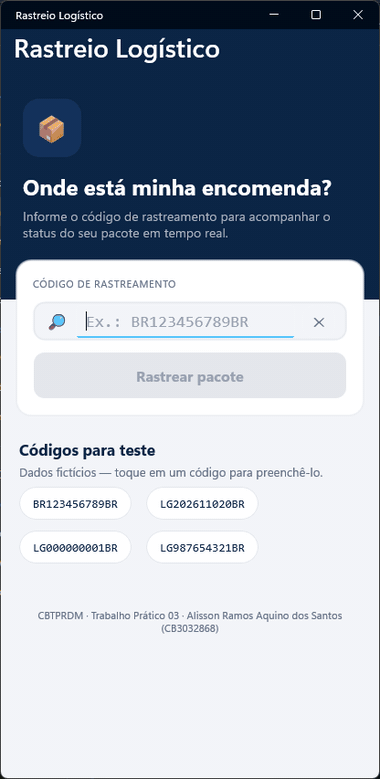

# 📦 Rastreio Logístico — .NET MAUI + MVVM

**CBTPRDM – Trabalho Prático 03** · IFSP Campus Cubatão · ADS
**Aluno:** Alisson Ramos Aquino dos Santos — **Prontuário:** CB3032868

Aplicação móvel de rastreamento de pacotes feita em **.NET MAUI** com **XAML** e padrão **MVVM**.
O cliente informa o código de rastreamento e vê o status atual do pacote, a data de envio, a
previsão de entrega, a localização atual e o histórico de eventos (dados fictícios).



## Funcionalidades

- **Página inicial** (`RastreioPage`): campo para o código, validação do formato (`AA123456789AA`),
  indicador de carregamento, mensagens de erro, códigos de teste e pesquisas recentes.
- **Página de resultados** (`ResultadoPage`): status com barra de progresso, localização atual,
  rota, data de envio, previsão de entrega, prazo (vermelho quando atrasado) e linha do tempo
  com o histórico de eventos (`CollectionView`).
- **Atualização "em tempo real"**: botão ⟳ Atualizar na barra e *pull-to-refresh* (`RefreshView`).
- **Navegação hierárquica** com `NavigationPage` (`PushAsync` / `PopAsync`) e botão
  "Rastrear outro pacote" para voltar.

## Arquitetura MVVM

```
Models/        Pacote, EventoRastreio, StatusPacote      → dados e regras de negócio
ViewModels/    BaseViewModel (INotifyPropertyChanged)
               RastreioViewModel                          → entrada do código, validação, busca
               ResultadoViewModel                         → dados formatados, atualizar, voltar
Views/         RastreioPage.xaml, ResultadoPage.xaml      → interface em XAML (bindings + commands)
Services/      IRastreioService / RastreioServiceFake     → busca simulada (dados fictícios)
               INavegacaoService / NavegacaoService       → navegação sem a ViewModel conhecer a View
Converters/    StatusParaCorConverter, StatusParaIconeConverter
```

- As Views só se ligam às ViewModels pelo `BindingContext`; o code-behind não tem lógica.
- As ViewModels expõem propriedades e `ICommand` e não referenciam nenhuma página.
- Os serviços são registrados por **injeção de dependência** em `MauiProgram.cs`.

## Códigos de teste (fictícios)

| Código | Situação |
|---|---|
| `BR123456789BR` | Em trânsito |
| `LG202611020BR` | Saiu para entrega |
| `LG000000001BR` | Entregue |
| `LG987654321BR` | Atrasado |

Qualquer outro código no formato válido retorna "Nenhum pacote encontrado".

## Como executar

Requisitos: .NET 10 SDK com o workload MAUI (`dotnet workload install maui`) ou Visual Studio 2022 17.14+ ou 2026
com a carga de trabalho ".NET Multi-platform App UI".

```bash
# Windows
dotnet build -t:Run -f net10.0-windows10.0.19041.0

# Android (emulador aberto ou aparelho conectado)
dotnet build -t:Run -f net10.0-android
```

No Visual Studio: abra `RastreioLogistico.csproj`, escolha *Windows Machine* ou um emulador Android e pressione **F5**.
